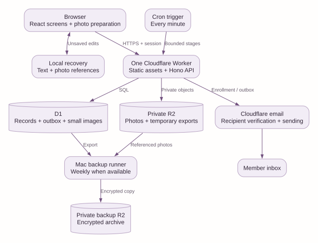
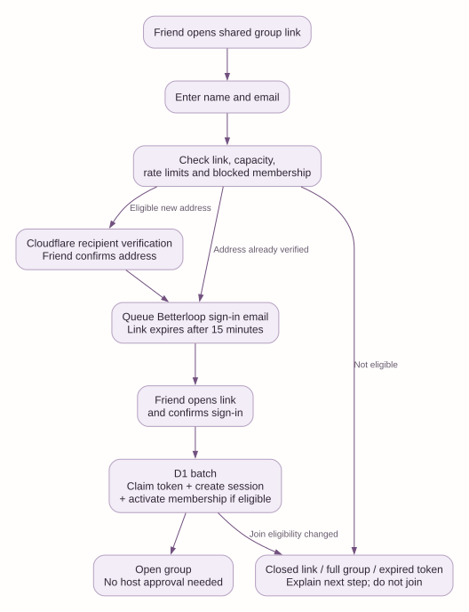
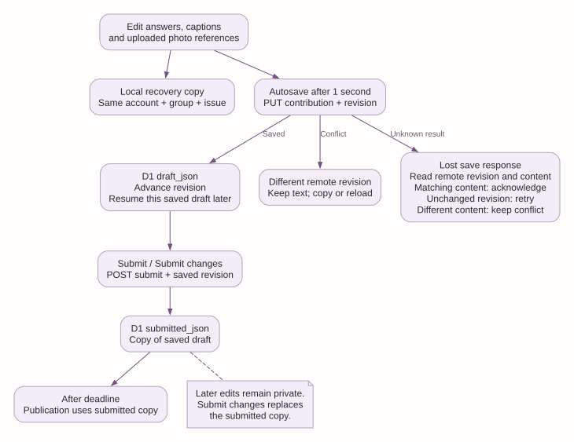
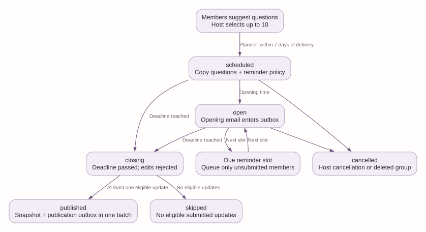
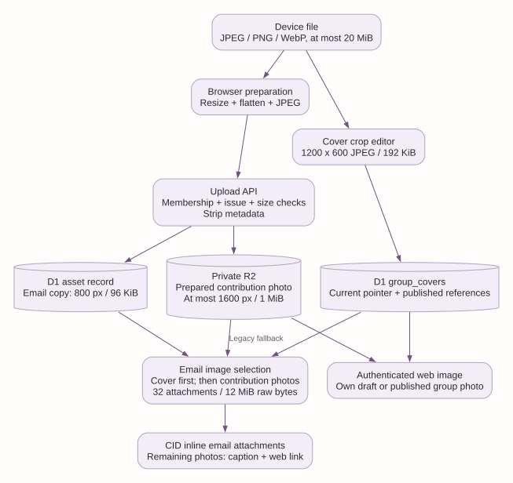
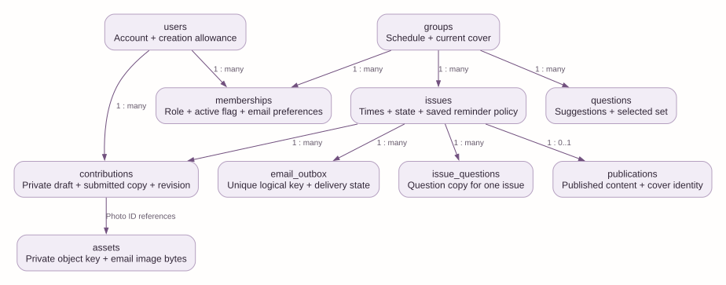
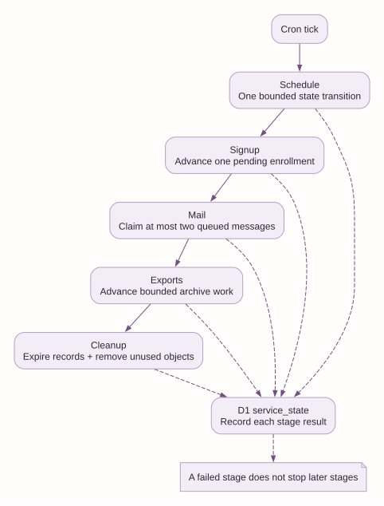

# Betterloop architecture and supported flows

Document ID: BL-ARCH-001  
Revision: 1  
Date: 2026-11-04  
Source baseline: `5ecfb589490c9654a14c10a50f06f5bee025107e`

## 1. Purpose and document rules

Betterloop makes private newsletters for small groups. Members answer questions and add photos. The application puts submitted updates into one letter.

This document describes the source at the baseline above. It does not contain private group records, invitation tokens, or credentials.

This document uses ASD-STE100 Issue 9 as its writing standard. It uses short sentences, active voice, consistent technical nouns, and numbered procedures. Section 14 defines the technical nouns. A specialist has not certified full dictionary compliance.

The diagrams describe current behavior. Dashed lines in the operations diagram show status records. They do not show another execution path.

## 2. System boundary

The application has one Cloudflare Worker. The Worker serves the React application and the Hono API. D1 holds durable records. Private R2 holds contribution photos and temporary exports.

The browser prepares photos before upload. It also keeps a local recovery copy of unsaved edits. The browser does not hold the authoritative submission.

A Cron trigger starts background work each minute. The same Worker performs this work. D1 contains the email outbox. The application does not use a separate queue service.

Cloudflare provides recipient verification and email sending. Email delivery depends on provider availability and recipient eligibility. Provider acceptance does not prove inbox delivery.

A separate Mac process creates encrypted backups. It puts backup files in private R2. This process needs the Mac to be available. Cron does not create weekly backups.

### 2.1 Module boundaries

| Concern | Main source | Responsibility |
| --- | --- | --- |
| Screen routing | `src/main.tsx` | Select screens and load account state. |
| Shared interface | `src/ui.tsx`, `src/styles.css` | Supply common controls, layout, and visual rules. |
| Group screens | `src/group-screens.tsx`, `src/owner.tsx` | Show groups and host controls. |
| Contribution editor | `src/composer.tsx`, `src/draft-store.ts` | Save edits, recover local text, and submit copies. |
| Image preparation | `src/photo.ts`, `src/cover.tsx` | Prepare contribution photos and cover crops. |
| Reader and preview | `src/reader.tsx`, `src/email-preview.tsx` | Show published letters and private email previews. |
| HTTP entry | `server/index.ts` | Apply headers, request limits, authentication, and routes. |
| Identity | `server/auth.ts`, `server/login.ts`, `server/security.ts` | Check sessions, roles, tokens, and request origin. |
| Enrollment | `server/shared-join.ts`, `server/email-enrollment.ts` | Verify addresses and join eligible members. |
| Group rules | `server/groups.ts` | Manage settings, questions, members, and invitations. |
| Issue rules | `server/issues.ts` | Save drafts, submit copies, withdraw, extend, and cancel. |
| Background work | `server/cron.ts`, `server/scheduler.ts` | Advance independent stages and issue states. |
| Email | `server/mail.ts`, `server/email-images.ts` | Claim messages, check eligibility, and build email. |
| Image access | `server/photos.ts`, `server/covers.ts`, `server/email-preview.ts` | Check private access and return images or previews. |
| Account lifecycle | `server/account.ts`, `server/privacy.ts`, `server/cleanup.ts` | Delete accounts, redact content, and remove unused data. |
| Exports | `server/exports.ts` | Build private archives in bounded steps. |
| Calendar rules | `shared/schedule.ts`, `shared/timezone.ts` | Calculate times with the group timezone. |
| Data contracts | `shared/contracts.ts`, `server/types.ts` | Define shared data structures and server bindings. |
| Backup and recovery | `scripts/backup.mjs`, `scripts/restore_sql.py`, `scripts/sanitize_restore.py` | Encrypt backups and prepare isolated recovery. |

Route modules call D1 directly. There is no separate repository layer. Shared security and calendar rules prevent repeated policy code.

## 3. Roles and capacity

| Role | Supported authority |
| --- | --- |
| Member | Join groups, suggest questions, edit their own update, read group letters, and set email preferences. |
| Administrator | Perform member actions. manage group settings, questions, covers, issues, and ordinary members. |
| Owner | Perform administrator actions. assign roles, transfer ownership, export the group, and delete the group. |
| Operator | Manage application enrollment, creation allowances, delivery problems, and operational status. |

A normal new account has a creation allowance of zero. This allowance controls how many groups the person can create. It does not prevent group membership or submissions.

The operator account starts with an allowance of five. The application permits five active groups in total. Each group permits twenty active members, including its owner.

Group membership provides access to private content. An operator flag alone does not grant access to another person's unpublished draft.

## 4. Join a group and sign in

### 4.1 Shared invitation flow

1. The host creates or enables a shared group link.
2. The friend opens the link and enters a name and email address.
3. The API checks the link, group capacity, blocked membership, and request limits.
4. Cloudflare verifies the email address if necessary.
5. Betterloop puts a sign-in email in the outbox after verification.
6. The friend opens the sign-in link and confirms sign-in.
7. A D1 batch claims the token and creates a session.
8. The batch activates group membership if the invitation remains eligible.
9. The application opens the group.

The shared link does not require host approval. The host can disable or rotate it. A full group rejects new membership. The final sign-in checks eligibility again.

A member removed by the host cannot use the shared link to return. A personal invitation can permit a return. A member who leaves voluntarily can use an eligible shared link again.

Signup status uses a temporary ticket. Background work can advance a pending verification. Request identifiers prevent duplicate signup records after repeated requests.

### 4.2 Personal invitation flow

The host can also invite one email address. The recipient verifies the address, signs in, and accepts the invitation. Acceptance checks the email, expiry, revocation, and capacity.

### 4.3 Return sign-in flow

An existing eligible account requests a sign-in email. A sign-in token expires after fifteen minutes. A new request invalidates earlier unused tokens for that account.

The confirmation action consumes a token once. Opening the link alone does not complete sign-in. An expired or used link requires a new request.

The session cookie is Secure and HttpOnly in production. The session lasts thirty days. Authenticated changes require the expected request origin and a CSRF token.

### 4.4 Failure behavior

| Condition | Result |
| --- | --- |
| Closed shared link | The friend must ask the host for another link. |
| Unverified address | Signup waits for recipient verification. |
| Full group | The application refuses new membership. |
| Expired sign-in token | The user requests a new sign-in email. |
| Duplicate token consumption | Only the first valid claim creates the session. |
| Suppressed address | The sender does not send queued email. |

## 5. Create a group and choose questions

The creator supplies a name, description, timezone, and recurrence. The API checks the creation allowance and total group limit. It creates the group and owner membership together.

The initial question set contains three starter questions. Members can add questions to the group collection. Owners and administrators select and order up to ten questions.

The collection holds at most two hundred questions. Selected questions remain selected until the host changes them. The application does not select random questions or rotate a question bank automatically.

A new issue receives copies of the selected questions and author names. Later changes to the collection do not change that issue. Members can suggest questions before the next issue.

An automatic issue needs at least one selected question. A group without selected questions shows a blocked state. It does not prevent other groups from advancing.

## 6. Write, save, submit, and edit again

### 6.1 Save progress

1. The member opens an issue before its deadline.
2. The editor loads the member's saved draft and submitted copy.
3. Each edit creates a local recovery copy when browser storage is available.
4. The editor starts an automatic save after one second without another edit.
5. Leaving a field can also start a save.
6. The API checks membership, issue state, deadline, and revision.
7. D1 stores the draft and advances its revision.
8. The editor removes the acknowledged local recovery copy.

A saved server draft can resume on another device after sign-in. Unsaved local recovery exists only on the original browser. It expires after seven days when accessed.

Local recovery contains text and photo references. It does not contain original image files or credentials. A selected file needs a successful upload before another session can use it.

Logout and account deletion clear local recovery. Browser storage can fail or be cleared. The editor shows a warning if it cannot keep a recovery copy.

### 6.2 Submit and change a submission

The Submit action first saves pending edits. The API then copies `draft_json` into `submitted_json`. The submitted copy is the content eligible for publication.

The member can return through the platform or an issue link before the deadline. An expired session requires a fresh sign-in link. An already consumed sign-in token cannot be reused.

Further edits change only the private draft. The previous submitted copy remains eligible. The member must use **Submit changes** to replace that copy.

The member can withdraw the submitted copy before the deadline. Withdrawal keeps the draft. The member can submit again while the issue remains open.

The server rejects edits, submission changes, and withdrawal at the deadline. This check does not depend on whether Cron has closed the issue yet.

### 6.3 Concurrent edits and uncertain saves

Each write includes the last known revision. A different remote revision produces a conflict. The editor keeps local text and asks the member to copy or reload.

A lost response can occur after a successful save. Before retrying, the editor reads the remote revision and content. Matching content confirms the earlier save. An unchanged revision permits a retry.

Different remote content remains a conflict. The editor does not silently overwrite it. Submission also reconciles an uncertain response against the submitted copy.

## 7. Open issues, remind members, and publish

### 7.1 Calendar and issue states

Groups support weekly, fortnightly, and monthly recurrence. Calendar calculations use the group timezone. Stored timestamps represent absolute instants.

The planner prepares an automatic issue within seven days of delivery. Its response window starts seven days before delivery. The normal submission deadline equals its delivery time.

The host can open an issue manually. The host can extend an active deadline, but cannot shorten it through the extension action. Extension also moves delivery time.

Only one scheduled, open, or closing issue can exist per group. A group pause cancels scheduled issues and skips queued opening or reminder messages. An already open issue can still close and publish.

### 7.2 Reminder policy

The host can configure zero to three reminder offsets. Each offset is a distinct whole number from one to 168 hours before the deadline. The default is forty-eight hours.

New issues copy the policy. Group policy changes affect future issues. Extending an active issue recalculates its remaining reminder schedule from that issue's saved policy.

Each reminder slot has a unique outbox identity. After downtime, the scheduler queues only the most recent due slot. It does not send every missed reminder.

A reminder targets active members without a submitted copy. The sender checks submission, preferences, address eligibility, deadline, and membership again before sending. A submitted member receives no reminder.

A withdrawn member can receive remaining future reminders. Completed reminder slots do not reopen. A short manually opened issue can receive one catch-up reminder before its deadline.

### 7.3 Publication and delivery

1. Cron finds an issue whose deadline has passed.
2. The scheduler changes its state to `closing`.
3. The scheduler reads eligible submitted copies from active members.
4. If no eligible copy exists, the scheduler marks the issue `skipped`.
5. Otherwise, it builds the publication with question copies and cover identity.
6. One D1 batch stores the publication and marks the issue `published`.
7. The same batch creates unique publication messages for eligible recipients.
8. Later outbox work sends the email copies.

Private drafts never enter the publication. Ordinary later edits cannot change the published content. Account deletion can redact content according to the deletion choice.

The web letter can be available before every email arrives. The production sender claims at most two messages per minute. Twenty recipients can require about ten ticks, with additional time for competing work or retries.

## 8. Upload photos and edit the cover

### 8.1 Contribution photos

The browser accepts JPEG, PNG, and WebP files up to twenty MiB. It prepares a JPEG up to 1600 pixels and one MiB. Each update permits three photos.

The browser also prepares an email copy up to 800 pixels and 96 KiB. The server checks upload bounds and removes image metadata. Private R2 holds the prepared contribution photo.

D1 holds asset ownership, object identity, and optional email image bytes. Drafts and submitted copies reference asset identifiers. The API rejects references from another member or issue.

Only the contributor can read an unpublished contribution photo. After publication, eligible group members can read included photos through authenticated endpoints. Removing a photo reference does not immediately destroy a previously submitted copy.

HEIC files are not supported. Text and photo captions together have a ten KB limit per update. Failed uploads do not become valid photo references.

### 8.2 Group cover

The owner or administrator can upload, crop, describe, save, replace, or remove a cover. The editor creates a 1200 by 600 JPEG. The server permits at most 192 KiB.

D1 holds cover bytes. The group points to its current cover. A publication records the cover identity and description used at publication time.

A later cover replacement does not change an earlier letter. Editing a saved crop permits further cropping. Restoring the original framing requires another upload of the original file.

Unreferenced replaced covers become eligible for cleanup after seven days. Cover storage has an application limit of sixty-four MiB. Compact email image storage has a separate limit of 250 MiB.

### 8.3 Email images and preview

Email uses CID inline attachments. Image selection gives the cover priority, followed by contribution photos. The builder permits at most thirty-two attachments and twelve MiB of raw image bytes.

A legacy photo without an email copy can use its prepared original. Photos beyond the attachment limit keep their captions and a private web link. Long emails use shorter text excerpts.

The web letter retains the complete text. Image endpoints remain private. Recipients can save or forward delivered email content, including attached images.

Before publication, the email preview shows only the current user's saved draft. This rule also applies to the host. After publication, the preview shows the redacted publication.

Preview scripts and forms are disabled. Images use authenticated application URLs. Browser preview tests do not prove identical rendering in every email client.

## 9. Durable data and access rules

D1 is the source of truth for group membership, issue state, revisions, and submission copies. R2 holds objects whose identities come from D1. Browser recovery is a temporary aid.

Unique keys prevent repeated logical email messages and duplicate issue creation. Conditional SQL writes check revisions and deadlines during the mutation. D1 batches keep related changes together.

The API checks active membership and the required role. Public web addresses do not make private images public. Production does not expose the local email inbox or development controls.

The server uses request limits, origin checks, CSRF checks, and restrictive response headers. API responses disable caching. Telemetry records request identity and operational results without recording full draft bodies.

### 9.1 Leave, remove, transfer, and delete

A member can leave a group. The owner must transfer ownership before leaving. Owners can assign administrators and transfer ownership to an eligible active member.

Removing a member disables membership and skips queued group mail. Administrators can remove ordinary members. Owners can also remove administrators.

Account deletion revokes access and invalidates affected exports. Publication reads apply deletion redaction immediately. Background cleanup then applies the changes to stored publications and objects.

Group deletion pauses the group, closes access, cancels pending issues, and skips queued mail. Bounded cleanup removes its content and private objects. Deletion does not recall email copies already delivered.

### 9.2 Profile, preferences, sessions, and email changes

A member can change the profile name. Each membership has separate preferences for opening, reminder, and publication email. Disabling a preference does not remove web access.

The account screen lists active sessions. The member can revoke one session or other sessions. Logout removes the current session and local recovery copies.

An email change requires an unused, verified, eligible destination address. An unverified address needs host confirmation before the member requests the change again. The current address remains active during this process.

The member confirms the change with a temporary token while signed in. Confirmation changes the address and revokes other sessions and unused sign-in tokens. Queued group messages use the new address.

Account deletion requires confirmation with the current email address. An owner must first transfer or delete owned groups. The member chooses whether published contributions should be removed.

## 10. Background work and email reliability

Cron runs schedule, signup, mail, exports, and cleanup in that order. Each stage has an independent error boundary. A failed cleanup stage does not stop that tick's earlier email work.

The scheduler advances one bounded task per call. Its priority is closure, opening, opening notice, reminder, then planning. Other groups can wait for a later tick.

Each stage records status and time in `service_state`. Operator screens show delivery failures, queue age, and backup summaries. These records need an operator to inspect them.

### 10.1 Outbox states

| State | Meaning |
| --- | --- |
| `queued` | The message can be claimed after its next attempt time. |
| `sending` | One sender holds a temporary claim. |
| `accepted` | The provider accepted the send request. |
| `skipped` | Eligibility, preferences, expiry, or issue state prevent sending. |
| `failed` | A known error or retry limit prevents further automatic sending. |
| `uncertain` | The application cannot determine the provider outcome. |

A conditional update claims a queued message for two minutes. Unique logical keys prevent duplicate enqueue operations. These keys cannot guarantee exactly one delivery by an external provider.

Known rate-limit errors use bounded retries with increasing delay. Unknown outcomes and expired send claims become `uncertain`. The application does not automatically resend uncertain messages.

Sign-in messages have priority. Message eligibility is checked immediately before sending. Old notification messages have a bounded delivery window.

### 10.2 Support flow

1. Ask the member for the failed action and its request identifier.
2. Check the operator screen for stage status, queue age, and address eligibility.
3. If necessary, check group membership, deadline, preferences, and submitted state.
4. Check the provider outcome before resolving a failed or uncertain notification.
5. Mark the notification accepted, or queue a retry after that check.
6. For sign-in or email-change messages, request a fresh link instead.

The resolution API requires confirmation that the operator checked the provider. It records the resolution in the audit log. The operator must not treat an uncertain result as a known failure.

## 11. Export, backup, and recovery

A member can request a personal export. The owner can request a group export. The API records a durable job, and Cron builds its private TAR archive in bounded steps.

Exports expire after twenty-four hours. Authorization is checked during work and download. Account or group deletion can invalidate an existing archive.

Group exports include the current cover and covers used by published letters. Photo files come from private R2. Temporary multipart state permits interrupted export work to continue.

The backup script exports D1 and referenced photos. It encrypts the archive before storing a backup copy. The recovery key must remain separate from the encrypted archive.

The weekly installation uses a macOS launch agent. It runs while the configured Mac is available. Private R2 storage does not make this schedule independent of the Mac.

Recovery must use an isolated destination. The recovery sanitizer pauses groups, disables sending, removes sessions and sign-in tokens, and closes shared links. It also expires exports.

The SQL writer splits large image values into bounded statements. Recovery checks must compare restored bytes. An operator must reconcile deletions and delivery history before any production recovery.

## 12. Supported-flow verification

The repository has isolated backend and browser tests. Test fixtures use fictional people and images. They do not send newsletters to production members.

| Flow or risk | Verification source |
| --- | --- |
| Shared join, verification, closed links, capacity | `tests/shared-join.test.ts` |
| Sign-in, access, revisions, submission rules | `tests/api.test.ts`, `tests/review-flows.test.ts` |
| Publication and repeated scheduled work | `tests/lifecycle.test.ts`, `tests/replay-lifecycle.test.ts` |
| Calendar, timezone, and recurrence | `tests/schedule.test.ts` |
| Reminders, isolation, and independent stages | `tests/repair-policy.test.ts`, `tests/operations.test.ts` |
| Image bounds and private access | `tests/photos.test.ts`, `tests/cover-email.test.ts` |
| Email escaping, attachments, and HTML size | `tests/mail.test.ts`, `tests/cover-email.test.ts` |
| Export, deletion, and cleanup | `tests/account-export.test.ts`, `tests/cleanup.test.ts` |
| Backup authorization and byte recovery | `tests/backup-auth.test.mjs`, `tests/recovery.test.mjs`, `tests/cover-restore.test.mjs` |
| Interrupted saves, local recovery, images, resubmission, and mobile layout | `e2e/review.spec.ts` |

CI installs the pinned Node version and runs format checks, type checks, backend tests, a production build, and browser tests. It retains browser evidence for fourteen days.

The source baseline has eighty-eight backend cases and ten browser cases. These counts describe that baseline. They do not replace inspection of the current CI result.

## 13. Limits and extension points

| Current limit | Effect or possible later change |
| --- | --- |
| Five groups and twenty members per group | Keep the pilot bounded. measure before increasing these values. |
| Two email claims per tick | Delivery spreads across ticks. increase only after capacity measurements. |
| One bounded scheduler task per call | Simultaneous deadlines can delay later groups. |
| No automatic question rotation | The host selects the next question set from member suggestions and starter questions. |
| No comments or reactions | Readers use another channel for discussion. |
| No events or shared album screen | Contribution photos remain part of letters. |
| Weekly backups depend on a Mac | A cloud runner needs a separate schedule and credential design. |
| Free-plan resource limits | Small successful runs do not establish maximum-load capacity or a permanent zero cost. |
| Email copies leave application control | Privacy deletion cannot remove copies from recipient inboxes. |
| Unsaved local text stays on one browser | Cross-device continuation needs a successful server save. |

Keep shared policy in the existing modules when adding a flow. Use explicit states and conditional writes for changes that can repeat. Add tests for a new failure boundary before changing delivery or persistence rules.

## 14. Technical noun register

| Technical noun | Meaning in this document |
| --- | --- |
| API | The HTTP interface used by application screens. |
| CID | An email content identifier that connects HTML to an inline attachment. |
| Cloudflare Worker | The deployed application process for requests and scheduled work. |
| Cron | The Cloudflare trigger for scheduled work. |
| CSRF token | A value used to check authenticated change requests. |
| D1 | The Cloudflare SQL database. |
| Draft | A private editable update that is not automatically eligible for publication. |
| Issue | One response window and its resulting letter. |
| Local recovery | A temporary browser copy of unsaved text and photo references. |
| Outbox | Durable database records for pending and completed email work. |
| Publication | The stored letter built from eligible submitted copies. |
| R2 | Private Cloudflare object storage. |
| Revision | A number used to detect concurrent changes. |
| Session | A temporary authenticated account connection. |
| Submitted copy | The saved draft copy that the member explicitly submits. |
| Token | A secret value that permits a limited action. |
| Host | The group owner or administrator who manages a group. |
| Operator | The person who manages the application deployment. |

## 15. References and maintenance

- [ASD-STE100 official specification](https://www.asd-ste100.org/assets/files/ASD-STE100_ISSUE9.pdf): writing rules and controlled vocabulary.
- [ASD-STE100 overview](https://www.asd-ste100.org/about_STE.html): purpose and structure of the writing standard.
- [Deployment and operations](DEPLOYMENT.md): configuration and pilot boundaries.
- [Repair notes](REPAIRS.md): repaired behaviors and acceptance criteria.
- [Cover and email photos](EMAIL_PHOTOS.md): image limits, privacy, and preview behavior.
- [Public source repository](https://github.com/bassimeledath/betterloop): code and CI history.

Update this document when a supported flow, role, state, storage location, or limit changes. Keep diagrams and text consistent. The editable diagram sources are in `docs/architecture/*.dot`.
